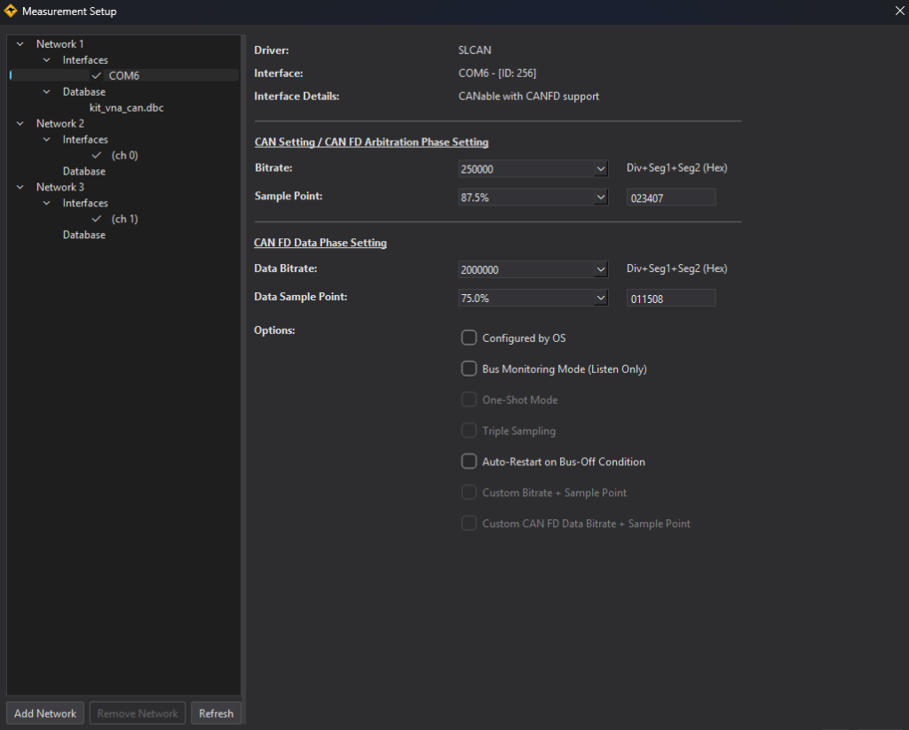
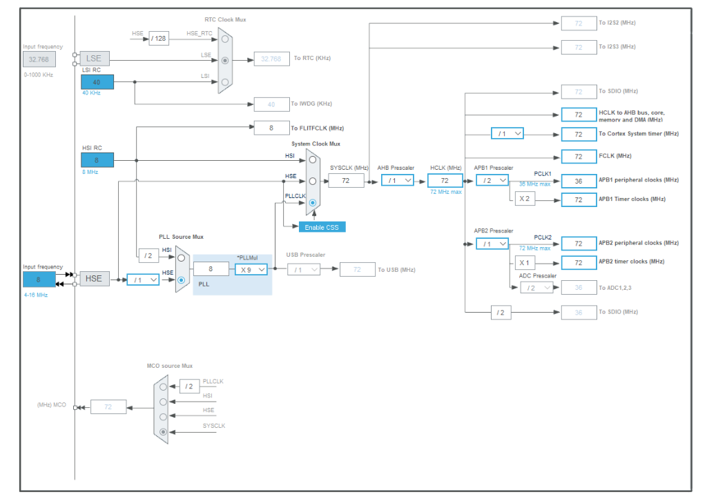
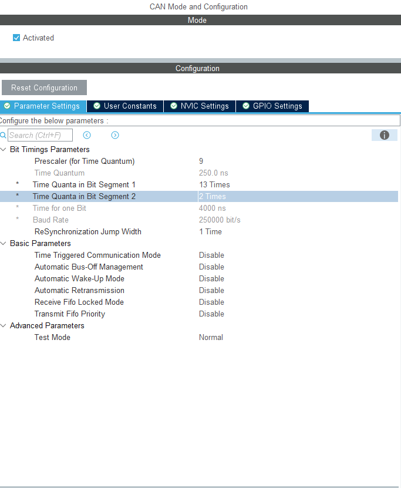

# TÀI LIỆU HƯỚNG DẪN SỬ DỤNG VÀ PHÁT TRIỂN FIRMWARE - KIT VNA

Dự án mạch Kit STM32F103RCT6 điều khiển đa năng giao tiếp CAN Bus, tích hợp đọc thẻ RFID, thẻ nhớ SD (phát nhạc MP3), cảm biến hồng ngoại, và LED 7 đoạn.

---

## 1. MÔI TRƯỜNG & PHẦN MỀM SỬ DỤNG
Để lập trình, biên dịch và giao tiếp với mạch, dự án sử dụng các phần mềm chuyên dụng sau:

- **STM32CubeMX (Phiên bản 6.17.0):** Công cụ sinh code tự động (C code) và cấu hình phần cứng (Clock, GPIO, SPI, I2C, CAN...). File cấu hình dự án là `Firmware.ioc`. Khi muốn thay đổi sơ đồ chân mạch, hãy dùng CubeMX để Generate Code ban đầu.
- **IAR Embedded Workbench (Phiên bản 8.40.1.21539):** Trình biên dịch (Compiler) và Môi trường phát triển (IDE) chính để viết code C++ và nạp chương trình. Sử dụng Workspace `Project.eww` nằm trong thư mục `EWARM/`. Mã nguồn của dự án được tối ưu rất sâu trên IAR, tận dụng trình biên dịch DLib và kiến trúc tối ưu bộ nhớ.
- **Cangaroo (Phiên bản 0.6.3):** Phần mềm giả lập màn hình HMI/PC mã nguồn mở. Dùng để gửi và nhận tín hiệu mạng CAN Bus giữa máy tính và mạch. Hỗ trợ import Database trực tiếp qua file `.dbc` để hiển thị tiếng Việt.

---

## 2. CẤU TRÚC THƯ MỤC DỰ ÁN

```Text
kit-test-01-mp3-module/
├── Core/
│   ├── Inc/                # Header thư viện C++ (.h)
│   │   ├── Buzzer.h        # Còi chip 
│   │   ├── CanBus.h        # Mạng CAN 
│   │   ├── Led7Segment.h   # LED 7 đoạn CD4094
│   │   ├── Mp3.h           # Phát nhạc VS1101E
│   │   ├── Relay.h         # Công tắc
│   │   ├── Rfid.h          # Thẻ RC522
│   │   ├── Rtc.h           # Thời gian DS1307
│   │   ├── SdCard.h        # Thẻ nhớ
│   │   ├── Sensor.h        # Cảm biến đếm
│   └── Src/                # Source code C/C++ (.cpp / .c)
│       ├── main.cpp        # Chương trình chính
│       ├── Sensor.cpp      
│       ├── stm32f1xx_it.c  # File chứa các ngắt hệ thống (SysTick, HardFault)
│       └── *.cpp           # (Các file mã nguồn tương ứng cho thư viện trong thư mục Inc/)
├── Drivers/                # Thư viện phần cứng (HAL) chính thức của hãng ST
├── EWARM/                  # Không gian làm việc (Workspace) của phần mềm IAR
│   └── Project.eww         # Mở file này bằng IAR để lập trình & biên dịch
├── FATFS/                  # Thư viện File System (FatFs) dùng để đọc thẻ SD
├── Middlewares/            # Các mã nguồn phần mềm trung gian liên quan đến FatFs
├── Firmware.ioc            # File cấu hình đồ họa hệ thống cho STM32CubeMX
├── kit_vna_can.dbc         # Database ánh xạ dữ liệu CAN cho Cangaroo
└── README.md               # Tài liệu đang đọc
```

---

## 3. HƯỚNG DẪN SỬ DỤNG DÀNH CHO NGƯỜI DÙNG

Phần này hướng dẫn chi tiết cách vận hành mạch từ lúc cắm điện đến lúc sử dụng các tính năng. 
### 3.1. Cắm điện và Khởi động
- **Cắm điện:** Ngay khi vừa cấp nguồn, mạch sẽ khởi động hệ thống và kêu **2 tiếng Bíp** để báo hiệu đã có điện và sẵn sàng.
- **Đèn LED Onboard :** Đèn LED nhỏ trên thân mạch sẽ chớp nháy liên tục rất nhanh (chu kỳ 0.1 giây sáng / 0.1 giây tắt - tức là chớp 5 lần/giây). Đèn này nháy đều đặn chứng tỏ  vi xử lý đang chạy ổn định, vòng lặp hoạt động không bị treo .
- **Màn hình LED 7 đoạn:** Sẽ bắt đầu tự động luân phiên hiển thị giữa 2 thông tin (mỗi thông tin hiển thị 5 giây):
  1. **Số lượng sản phẩm đã đếm được:** Dấu chấm ở giữa màn hình sẽ **TẮT**.
  2. **Giờ hiện tại (Giờ:Phút):** Dấu chấm ở giữa màn hình sẽ **NHẤP NHÁY** theo từng giây.

### 3.2. Tín hiệu Còi (Buzzer) và Cảnh báo
Hệ thống còi bíp đã được tinh chỉnh để chạy hoàn toàn đa nhiệm (có hàng chờ) nên các tiếng bíp sẽ lần lượt phát ra mượt, không bị dính hoặc nuốt tiếng của nhau. 

Mạch được quy định phản hồi các thao tác thông qua số lượng tiếng bíp như sau:

| Âm thanh | Tình huống | Ý nghĩa chi tiết |
| :--- | :--- | :--- |
| **1 Bíp ngắn** | **Thành công** | - Có sản phẩm chạy qua mắt cảm biến.<br>- Nhận diện thành công có thẻ RFID quẹt qua.<br>- Cập nhật thành công cài đặt mới từ phần mềm máy tính (CAN Bus: Mục tiêu, Bộ đếm, Xem giờ). |
| **2 Bíp ngắn** | **Lỗi Dữ liệu / Cảnh báo nhẹ** | - **Khởi động:** Báo hiệu mạch vừa khởi động/cấp điện thành công.<br>- **Thẻ SD (Hot-plug):** Cắm thẻ SD thành công khi mạch đang chạy.<br>- **CAN Bus:** Gửi cài đặt Mục tiêu / Số đếm lớn hơn `9999` (Vượt quá giới hạn màn hình LED).<br>- **Quẹt Thẻ (RFID):** Sai mật khẩu thẻ.<br>- **Quẹt Thẻ (RFID):** Lỗi giao tiếp với chip nhớ trong thẻ (không đọc được Block).<br>- **Quẹt Thẻ (RFID):** Dữ liệu trong thẻ bị sai lệch (VD: Không chứa các lệnh hợp lệ như `RESET_DEM`, `BAT_RELAY`...).<br>- **Quẹt Thẻ (RFID) Thao tác thừa:** Ví dụ thẻ mang lệnh bắt "Bật Relay" nhưng Relay đang bật sẵn, hoặc thẻ mang lệnh "Reset bộ đếm" nhưng số đếm đang là 0 sẵn rồi. |
| **3 Bíp ngắn** | **Lỗi Phần cứng / Module MP3** | - **Lỗi Thẻ Nhớ SD:** Thẻ nhớ bị lỗi định dạng (yêu cầu FAT32), chưa cắm thẻ nhớ, hoặc khe cắm hỏng tiếp xúc phần cứng.<br>- **Lỗi Module MP3:** Module âm thanh MP3 bị treo không phản hồi, hoặc thẻ nhớ không có tệp `.MP3` tương ứng với hành động. |
| **1 Bíp Dài**<br>*(Nửa giây)* | **Lỗi Mất Mạng CAN** | - Không gửi được dữ liệu qua đường truyền CANBUS


**Tín hiệu Cảnh báo trên Màn hình LED:**
- **Lỗi đứt cáp mạng CAN:** Nếu mạch phát hiện dữ liệu gửi qua mạng CAN bị lỗi, ở chế độ đếm số, **dấu chấm ở giữa màn hình sẽ nhấp nháy liên tục rất nhanh (5 lần/giây)** để cảnh báo dữ liệu không gửi được lên máy tính. Ngay khi khôi phục lại kết nối canbus, phần cứng sẽ tự khôi phục và dấu chấm tự động ngừng nhấp nháy (hệ thống về trạng thái bình thường).
- **Lỗi mất thời gian thực (Hết pin RTC):** Nếu mạch bị mất thời gian thực. Khi hiển thị chế độ Xem giờ, thay vì hiện `Giờ:Phút`, màn hình sẽ hiện chữ `----` nhấp nháy mãi mãi để báo lỗi. Lúc này cần nạp lại thời gian qua CAN Bus (Cangaroo).

### 3.3. Hướng dẫn đếm sản phẩm bằng Cảm biến
- **Cách đếm:** Khi có sản phẩm chạy ngang qua mắt cảm biến, còi kêu 1 tiếng **Bíp** và số trên màn hình tăng lên 1. 
- **Khi màn hình đang hiển thị chế độ "Xem giờ":** Nếu cảm biến bắt được sản phẩm, màn hình sẽ **lập tức nhảy về chế độ Số Đếm** để dễ dàng theo dõi.
- **Đạt mục tiêu:** Khi số lượng sản phẩm đếm được bằng với con số "Mục tiêu" (có thể cài đặt qua máy tính bằng canbus), loa sẽ tự động phát âm thanh "Đã đạt mục tiêu" (tên file là `DAT.MP3`).

### 3.4. Hướng dẫn sử dụng Thẻ Nhớ MP3 (Thẻ SD)
- **Chuẩn bị thẻ:** Rút thẻ ra cắm vào máy tính, Format thẻ với định dạng **FAT32**. Sau đó copy các file âm thanh (đuôi file là `.mp3`) trực tiếp vào thẻ, không bỏ vào thư mục nào cả. 
- **Rút/Cắm thẻ khi đang chạy (Hot-plug):** Nếu đang phát âm thanh mà vô tình rút thẻ ra -> Mạch sẽ kêu **1 tiếng bíp**, đồng thời tự động ngắt amply để loa không bị nổ lụp bụp và lưu lại vị trí bài hát đang nghe dở. Khi cắm thẻ lại thành công -> Mạch sẽ kêu **2 tiếng bíp** nếu kết nối thành công, đồng thời **màn hình LED 7 đoạn sẽ hiển thị thời gian kết nối thẻ (tính bằng mili-giây) trong vòng 3 giây**, sau đó mạch tự động phát tiếp đoạn âm thanh vừa bị ngắt.

### 3.5. Hướng dẫn Quẹt thẻ Thao tác (RFID)
Mạch đi kèm bộ thẻ từ. Quẹt các thẻ này vào anten (miếng vuông in chữ RC522) để ra lệnh cho mạch làm việc:
- Quẹt thẻ **RESET**: Mạch tự động xóa số đếm sản phẩm về 0 và loa phát bài `RESET.MP3`.
- Quẹt thẻ **BAT**: Bật công tắc điện (Relay) trên mạch, loa phát bài `BAT.MP3`.
- Quẹt thẻ **DAO**: Đổi ngược trạng thái công tắc (Đang bật thành tắt, đang tắt thành bật), loa phát bài `DAO.MP3`.
- Quẹt thẻ **PHAT_NHAC**: Ra lệnh cho loa phát một bài nhạc giải trí tên là `MUSIC.MP3`.
*( Có thể quẹt liên tục nhiều thẻ khác nhau, các âm thanh sẽ tự động xếp hàng và phát lần lượt).*

### 3.6. Hướng dẫn dùng phần mềm máy tính (Cangaroo qua CAN Bus)
Cắm mạch vào máy tính qua bộ chuyển đổi CAN. Mở phần mềm **Cangaroo** trên máy tính:

**Cấu hình kết nối phần cứng:**
1. Trên thanh Menu Cangaroo, vào **Measurement -> Measurement Setup...**
2. Tại mục **Interfaces**, chọn cổng COM tương ứng của bộ chuyển đổi CAN (ví dụ: `COM6`).
3. Đặt **Bitrate** là `250000` (đây là tốc độ baud mặc định của firmware).
4. Bấm **Start Measurement** (nút màu xanh hình nút Play) để bắt đầu quét mạng CAN.



**Sử dụng Cangaroo để Gửi/Nhận dữ liệu:**
1. Vào thanh Menu **View -> Generator** để mở bảng Gửi lệnh (Generator View).
2. Tại bảng **Available Messages (DBC)**, bấm nút **Add DBC Message**, tìm file `kit_vna_can.dbc` (có sẵn trong thư mục dự án) để Load vào phần mềm.
3. Lúc này toàn bộ các ID kỹ thuật sẽ tự động biến thành tiếng Việt (Ví dụ: *Thoi_Gian_Thuc_RTC, Muc_Tieu...*).


4. **Cách đổi số lượng Mục Tiêu:** Tìm đến khung CAN TX (ID `0x201`), nhập một số thập phân bình thường (ví dụ: `100`) rồi bấm nút Gửi (Send). Mạch sẽ nhớ con số 100 này làm mục tiêu.
4. **Cách chỉnh giờ khi đồng hồ sai:** Tìm đến khung CAN TX (ID `0x203`), nhập đúng thứ tự: *Ngày(1->31), Tháng(1->12), NăM(0->99), Thứ(1->7)*. Khung giờ nhập *Giờ(0->23), Phút(0->59), Giây(0->59)* (Dưới dạng số thập phân thông thường), rồi bấm Gửi (Send). Mạch sẽ nhận giờ lập tức, hết nhấp nháy chữ `----`.
5. **Cách đặt số đếm bất kỳ:** Tìm khung CAN TX (ID `0x202`), nhập một số bất kỳ (ví dụ: `50`), bấm Gửi, mạch sẽ lập tức nhảy số đếm về 50.

6. **Thay đổi tính năng của Thẻ RFID (Nạp lệnh mới vào thẻ):**
   - Mở khung CAN TX **`ID 0x204 (Cai_Dat_Tinh_Nang_RFID)`**.
   - Tại cột **Value**, nhập 1 trong các số sau tùy theo chức năng muốn cài:
     - `1`: Reset đếm (`RESET_DEM`)
     - `2`: Bật Relay (`BAT_RELAY`)
     - `3`: Đảo Relay (`DAO_RELAY`)
     - `4`: Phát nhạc (`PHAT_NHAC`)
   - Bấm Gửi. Mạch sẽ kêu **2 bíp ngắn dồn dập (50ms)** báo hiệu đang ở chế độ chờ ghi thẻ. Lúc này quẹt thẻ từ vào anten, mạch sẽ nạp lệnh mới vào thẻ. (Quẹt xong sẽ có tiếng bíp dài báo thành công).
   *(Lưu ý : Để có thể thay đổi tính năng thẻ thì yêu cầu mật khẩu (key A) của thẻ phải là **0x11 0x22 0x33 0x44 0x55 0x66**)
7. **Đổi mật khẩu / Xóa trắng thẻ RFID:**
   - Mở khung CAN TX **`ID 0x205 (Cai_Dat_Mat_Khau_The)`**.
   - Cột **Lenh_Dieu_Khien (Byte 0):** Nhập `0` nếu muốn Xóa tính năng của thẻ , hoặc nhập `1` nếu muốn Đổi mật khẩu mới.
   - **Cách điền Mật khẩu mới:**
     - Nếu muốn nhập mật khẩu bằng hệ **Hexa**, hãy click đúp chuột trực tiếp vào khung **Data** (chữ số ngoài cùng) và sửa trực tiếp chuỗi Hex (Ví dụ: `01 0F FF FF FF FF FF` rồi ấn Enter). 
     - Nếu nhập từng cột Value, hãy quy đổi ra số Thập phân (Ví dụ `0xFF` thì gõ là `255`, `0x0F` thì gõ là `15`). 
   - Bấm Gửi. Mạch kêu **2 bíp dồn dập** chờ thẻ. Quẹt thẻ để hoàn tất quá trình đổi mật khẩu.
    *(Lưu ý : Để có thể đổi mật khẩu mới cho thẻ cần biết mật khẩu hiện tại của thẻ)*

8. **Cấp Chìa khóa Tạm thời :**
   - Theo mặc định, mạch sẽ tự động truy cập thẻ bằng mật khẩu (Key A) là `11 22 33 44 55 66`. Tuy nhiên, nếu thẻ có mật khẩu lạ, sẽ không thể thao tác Ghi lệnh (Bước 6) hay Xóa/Đổi mật khẩu (Bước 7) được nữa, mạch sẽ kêu 2 tiếng bíp dài báo sai mật khẩu.
   - Để khắc phục, cần mở khung CAN TX **`ID 0x206 (Cai_Dat_Mat_Khau_Tam_Thoi)`**.
   - Tại phần Data, nhập 6 byte mật khẩu hiện tại của thẻ (ví dụ `AA BB CC DD EE FF`), rồi bấm Gửi.
   - Mạch sẽ kêu **2 bíp ngắn dồn dập**. Ngay lúc này, mạch đã lưu chìa khóa tạm thời vào bộ nhớ RAM. Có thể tiến hành gửi lệnh `0x204` (Đổi tính năng) hoặc `0x205` (Xóa/Đổi mật khẩu) như bình thường. Chìa khóa tạm này sẽ được sử dụng cho đúng 1 lần quẹt thẻ kế tiếp.

9. **Quan sát Dữ liệu Mạch gửi lên PC (Monitor):**
   - Chuyển sang bảng **CAN RX** (Hoặc tab Monitor) để xem mạch báo cáo trạng thái theo thời gian thực:
   - **`ID 0x101`**: Thông báo có thẻ vừa quẹt. Xem được mã ID của thẻ (5 byte đầu) và trạng thái đọc thẻ (Byte cuối: `0` là Đọc thành công, `1-3` là có lỗi).
   - **`ID 0x102`**: Gửi liên tục thông số Số đếm hiện tại, Mục tiêu và Chu kỳ (số lần đếm được 10000 ). (Có thể thấy số đếm nhảy lên ngay lập tức trên máy tính khi che tay qua cảm biến).
   - **`ID 0x103`**: Gửi liên tục Thời gian thực (giờ,phút,giây,ngày,tháng,năm,thứ) từ vi điều khiển để đồng bộ.
   - **`ID 0x104 & 0x105`**: Chứa chuỗi ký tự dữ liệu (16 byte) mạch đọc được từ Thẻ RFID khi quẹt thẻ.
   - **`ID 0x124`**: (Chế độ Diagnostic) Liên tục cập nhật thời gian che và thời gian khoảng trống của cảm biến (ms). Dùng để gỡ lỗi khi có nhiễu.
   - **`ID 0x125`**: Báo cáo thời gian khởi tạo thẻ nhớ SD (Mount Time - tính bằng ms) ngay khi thẻ được cắm nóng.

---

## 4. HƯỚNG DẪN SỬ DỤNG THƯ VIỆN CHO LẬP TRÌNH

Mã nguồn được viết theo cấu trúc Hướng đối tượng (OOP) C++. Các tác vụ liên tục trong vòng lặp chính (như kiểm tra cảm biến, nháy LED) dùng hàm `HAL_GetTick()` để không chặn chương trình (Non-blocking). Hàm `HAL_Delay()` vẫn được dùng ở các tác vụ ngắn hoặc khi khởi tạo thiết bị.

**Lưu ý:** Bộ thư viện này được tối ưu trên nền tảng STM32 HAL (Chip **STM32F1**). Tất cả các thiết lập chân (Pin/Port) đều được truyền thẳng qua hàm khởi tạo (Constructor), giúp tái sử dụng với project khác.

---


### 4.1. Bắt Đầu Nhanh
**Bước 1: Mở phần mềm lập trình**
- Cài đặt phần mềm **IAR Embedded Workbench**.
-Vào thư mục EWARM, click đúp chuột vào file **Project.eww** để mở dự án.
- Phía bên trái phần mềm, mở nhánh thư mục Application/User/Core và click đúp vào file main.cpp để bắt đầu viết code.

**Bước 2: Biên dịch (Kiểm tra lỗi)**
- Bấm nút **Make** (hoặc nhấn phím tắt F7). 
- Phần mềm sẽ dịch code C++ của bạn. Nếu bảng thông báo bên dưới hiện chữ Errors: 0 là thành công.

**Bước 3: Nạp code xuống mạch**
- Cắm mạch vào máy tính qua cổng nạp ST-Link (Chân SWDIO, SWCLK).
- Bấm nút **Download and Debug** (hoặc Ctrl + D). Code sẽ được nạp vào chip.
- Bấm nút hình "Dấu X" đỏ để thoát chế độ Debug, sau đó mạch sẽ tự động chạy code mới.

---

### 4.3. Cấu hình Hệ thống & Xung nhịp (System Core & Clock Tree)
Để vi điều khiển hoạt động chính xác với các giao thức tốc độ cao (như CAN, SPI), bắt buộc phải cấu hình xung nhịp gốc trong STM32CubeMX như sau:
- **Chuẩn nạp (SYS):** Cấu hình Serial Wire (`PA13` - SWDIO, `PA14` - SWCLK).
- **Thạch anh (RCC):** Kích hoạt High Speed Clock (HSE) ở dạng Crystal/Ceramic Resonator.
- **Clock Tree:** 
  - Input HSE: **8 MHz**.
  - PLL Source Mux: Chọn **HSE**.
  - PLLMul: Đặt hệ số nhân **X9** (8 x 9 = 72).
  - System Clock Mux: Chọn **PLLCLK** để đẩy SYSCLK lên **72 MHz**.
  - **AHB Prescaler:** `/1` (HCLK = 72 MHz).
  - **APB1 Prescaler:** Bắt buộc `/2` (PCLK1 = 36 MHz) để không làm quá tải bus I2C/CAN.
  - **APB2 Prescaler:** Đặt `/1` (PCLK2 = 72 MHz) để chạy ngoại vi SPI tốc độ tối đa.



---

### 4.3. Thư viện `Buzzer` (Còi Chip)
Thư viện quản lý còi thông qua hàng chờ (Queue), cho phép đẩy nhiều tín hiệu bíp mà không làm treo hệ thống.

**Cách hoạt động:** Khi gọi lệnh kêu, thư viện chỉ lưu số liệu vào mảng hàng chờ. Hàm `update()` được đặt ngầm trong bộ đếm ngắt sẽ liên tục trừ lùi thời gian để điều khiển điện áp ngõ ra (Bật/Tắt).

**Hàm API chi tiết:**
- `Buzzer(GPIO_TypeDef* port, uint16_t pin)`: Constructor truyền vào chân kết nối.
- `void init()`: Cấu hình chân GPIO thành Output Push-Pull. (Nên cấu hình thẳng bằng Register trong `main.cpp` để tăng tốc độ).
- `void beep(uint8_t count, uint32_t onTime, uint32_t offTime, bool force)`:
  - `count`: Số lần kêu (VD: 3 lần).
  - `onTime`: Độ dài thời gian kêu (mili-giây).
  - `offTime`: Độ dài thời gian im lặng (mili-giây).
  - `force` (Mặc định = false): Nếu set là `true`, lập tức xóa bỏ hàng chờ cũ và kêu ngay lệnh này.
- `void update()`: **BẮT BUỘC**. Hàm đếm thời gian.

**Ví dụ Code hoàn chỉnh:**
```cpp
/* --- Khai báo toàn cục --- */
#include "Buzzer.h"
Buzzer buzzer(GPIOC, GPIO_PIN_15); 

int main(void) {
    buzzer.init();
    
    // Kêu 3 lần, mỗi tiếng 100ms, nghỉ 100ms. Sẽ chạy ngầm.
    buzzer.beep(3, 100, 100);       
    
    // Nếu dùng force=true, tiếng bíp này sẽ cắt ngang tiếng bíp ở trên!
    // buzzer.beep(1, 100, 0, true); 
    
    while(1) { /* Main rảnh rỗi */ }
}

/* --- DUY TRÌ THỜI GIAN --- */
// Phải ghi đè hàm đếm mili-giây của HAL và bỏ update() vào đây!
extern "C" {
    void HAL_IncTick(void) {
        uwTick += uwTickFreq;
        buzzer.update(); 
    }
}
```

**Ghi đè hàm HAL_IncTick**
Hàm HAL_IncTick() là hàm ngắt Timer hệ thống (SysTick) của vi điều khiển, tự động kích hoạt 1000 lần mỗi giây (tương đương mỗi mili-giây).
Việc đặt `buzzer.update()` vào trong hàm ngắt này có ý nghĩa cực kỳ quan trọng:
- **Đếm thời gian siêu chuẩn:** Đảm bảo còi luôn được cập nhật trạng thái (bật/tắt) chính xác tới từng mili-giây, bất kể hàm main() đang bận làm việc gì (đọc thẻ nhớ, xử lý LED, v.v.).
- **Chạy ngầm độc lập (Background Task):** Chuyển thư viện Còi thành hệ thống chạy ngầm. Chỉ cần ra lệnh `buzzer.beep(...)` một lần duy nhất, ngắt SysTick sẽ tự động lo việc trừ lùi thời gian và tắt còi đúng lúc mà không cần dùng `HAL_Delay`, giúp chương trình không bao giờ bị treo cứng.

---

### 4.4. Kiến trúc cốt lõi SPI Đa năng (`SpiBus`)
Thư viện `SpiBus` là nền tảng cốt lõi quản lý toàn bộ giao tiếp SPI của hệ thống.
**A. Các chế độ khởi tạo SPI:**
- **Chế độ 1 - Dùng cấu hình CubeMX:** Giao toàn quyền cho CubeMX cấu hình clock và chân cắm.
  ```cpp
  SpiBus spi1_bus(SPI1); // Quản lý SPI1
  SpiBus spi2_bus(SPI2); // Quản lý SPI2
  SpiBus spi3_bus(SPI3); // Quản lý SPI3
  ```
- **Chế độ 2 - Cấu hình Bare-metal tự động:** Thư viện sẽ tự động cấp xung nhịp (Clock) và kích hoạt chân GPIO (Alternate Function). Bạn không cần mở CubeMX.
  ```cpp
  // Ví dụ khởi tạo SPI1 với các chân PA5, PA6, PA7
  SpiBus spi1_bus(SPI1, GPIOA, GPIO_PIN_5, GPIOA, GPIO_PIN_6, GPIOA, GPIO_PIN_7);
  ```
- **Chế độ 3 - SPI Mềm (Bit-banging):** Điều khiển trực tiếp các chân GPIO bằng CPU mà không sử dụng bộ SPI cứng bên trong chip. Phù hợp cho các dự án thiếu chân.
  ```cpp
  // Bỏ tham số SPI cứng đi, chỉ truyền vào GPIO
  SpiBus spi_mem(GPIOA, GPIO_PIN_5, GPIOA, GPIO_PIN_6, GPIOA, GPIO_PIN_7);
  ```

**B. Cơ chế tăng tốc bằng DMA (Tối đa hóa băng thông):**
Thư viện SpiBus hỗ trợ truyền dữ liệu tốc độ cao bằng DMA (hiện tại hoạt động theo cơ chế Polling - Vòng lặp chờ cờ phần cứng).
- **Lưu ý quan trọng:** Tính năng DMA **chỉ hoạt động với SPI cứng** (Chế độ 1 và 2). Bạn không thể bật DMA nếu đang khởi tạo đối tượng ở Chế độ 3 (SPI Mềm/Bit-banging).
- **Tại sao chưa dùng ngắt DMA chuẩn (Interrupt-driven)?**
  - Trong dự án này, hệ thống chạy dạng vòng lặp đơn (Super-loop), và thư viện thẻ nhớ FatFs hoạt động theo cơ chế **đồng bộ** (gọi hàm đọc thẻ thì phải chờ có đủ dữ liệu trên tay mới chạy tiếp code bên dưới). 
  - Do đó, dù có bật Ngắt DMA, vi điều khiển vẫn bắt buộc phải tạo một vòng lặp `while(!dma_done)` để đứng chờ cờ báo hoàn thành. Cách này không giải phóng được vi điều khiển mà còn làm hệ thống ngắt phức tạp thêm.
  - Mục đích chính của DMA ở đây không phải là đa nhiệm, mà là để **loại bỏ độ trễ do vòng lặp phần mềm khi gửi từng Byte**. Bộ DMA cứng tự động bơm chuỗi Byte liên tục ra chân SPI không có khoảng nghỉ, giúp thẻ SD đạt tốc độ cực cao, giải quyết triệt để lỗi giật cục (stuttering) khi phát MP3.
- **Nếu muốn dùng ngắt DMA thì cần gì?**
  - Dự án cần phải nâng cấp lên dùng Hệ điều hành thời gian thực (**RTOS** như FreeRTOS).
- **Cách dùng DMA hiện tại để tái sử dụng:** Thư viện đã tự động mapping kênh DMA chuẩn cho từng bộ SPI cứng (VD: SPI1 nối DMA1 CH2/3). Bạn **không cần** cấu hình DMA hay bật ngắt trong CubeMX. Chỉ cần:
  1. `spi_bus.EnableDMA(true);` (Bật tính năng DMA)
  2. Dùng hàm `spi_bus.TransferDMA(tx_buf, rx_buf, size);` thay cho `TransferBuffer()` để truyền mảng dữ liệu lớn.
---

### 4.5. Thư viện `Mp3` (IC Giải mã VS1011e) & Thẻ nhớ (`SdCard`)

> **[📝 Xem tài liệu Hướng Dẫn Sử Dụng Thư viện SdCard và FatFs đầy đủ tại đây](README_SdCard.md)**

Sự kết hợp giữa `SdCard` (đọc thẻ vật lý) và `Mp3` (giải mã tín hiệu số). Quá trình diễn ra như sau: Vi điều khiển (MCU) đọc luồng Byte từ thẻ nhớ (SPI) vào bộ đệm (Buffer) trong RAM, sau đó MCU bơm liên tục dữ liệu từ bộ đệm này sang chip giải mã VS1011 (SPI)."

**Hàm API chi tiết thư viện `Mp3`:**
- Mp3(...): Constructor truyền vào con trỏ SPI (&hspi2) và 5 chân điều khiển: PWR_EN (chân cấp nguồn), XRESET, DREQ, XDCS, XCS.
- void init(): Bật IC giải mã và cấu hình thanh ghi nội bộ.
  > **Bên trong init():** Thư viện sẽ tự động cấu cho 5 chân GPIO. 
  > - PWR_EN, XRESET, XDCS, XCS được cấu hình thành **Output Push-Pull** (Mức cao = 3.3V, Mức thấp = 0V) với tốc độ xuất 50MHz để điều khiển IC.
  > - DREQ (Data Request) được cấu hình thành **Input Floating** để lắng nghe tín hiệu báo "đói dữ liệu" từ chip VS1011 gửi về vi điều khiển.
  > - Sau khi set GPIO, hàm sẽ kéo PWR_EN xuống LOW để bật nguồn cho mạch MP3, delay 100ms cho điện áp ổn định rồi mới nạp thanh ghi qua SPI.
- `void play(const char* filename)`: Tìm và mở file MP3. Hỗ trợ hàng chờ (Playlist). Nếu đang hát mà gọi tiếp `play()`, file mới sẽ đợi file cũ hát xong.
- `void setVolume(uint8_t left, uint8_t right)`: Chỉnh âm lượng (0 = Max, 254 = Min/Tắt, 255 = Power down).
- `void process()`: **QUAN TRỌNG NHẤT**. Đặt trong `while(1)`. Hàm này sẽ kiểm tra chân `DREQ`. Chân này ở mức CAO nghĩa là IC VS1011 chưa có dữ liệu. Hàm sẽ tự lấy 32 bytes từ Buffer đẩy qua SPI. Nếu quên hàm này, âm sẽ thanh không kêu.
- `void saveState()` và `resumeState()`: **Hot-Plug (Cắm/rút nóng thẻ)**. Giúp ghi nhớ bài hát đang hát dở để khi cắm thẻ lại, bài hát tự hát tiếp vị trí vừa đứt.

**Chi tiết thư viện SdCard và Cầu nối FatFs (Kiến trúc phân tầng):**
Thư viện `SdCard` không hoạt động độc lập mà đóng vai trò là "Cầu nối" trong một kiến trúc 3 tầng:
1. **Tầng Ứng dụng (`main.cpp`):** Chỉ cần gọi hàm cấp cao của FatFs như `f_mount`, `f_open` để mở file âm thanh.
2. **Tầng Hệ điều hành File (`FatFs`):** FatFs làm nhiệm vụ dịch các yêu cầu mở file thành địa chỉ logic. Nhưng FatFs lại không biết cách giao tiếp SPI với STM32.
3. **Tầng Vật lý (`SdCard.cpp`):** Đây chính là thư viện đóng vai trò làm giao tiếp qua SPI với STM32.

**1. Khai báo thư viện SdCard:**
```cpp
// 1. Khai báo SPI cho thẻ nhớ
SpiBus spi1_bus(SPI1, GPIOA, GPIO_PIN_5, GPIOA, GPIO_PIN_6, GPIOA, GPIO_PIN_7); 

// 2. Khai báo SdCard với các chân điều khiển phụ
// SdCard(SpiBus* spi_bus, CS_Port, CS_Pin, CD_Port, CD_Pin, PWR_Port, PWR_Pin)
SdCard sdCard(&spi1_bus, GPIOC, 1<<8, GPIOB, 1<<0, GPIOB, 1<<1); 
```
> **Giải thích các chân:**
> - **CS (Chip Select):** Chọn thẻ nhớ để giao tiếp SPI (kéo xuống LOW khi truyền).
> - **CD (Card Detect):** Chân phát hiện có thẻ cắm vào khe hay không (thường bị kéo xuống LOW khi có thẻ).
> - **PWR (Power Control):** Chân điều khiển transitor để cấp nguồn 3.3V cho thẻ nhớ.

**2. Giao tiếp giữa FatFs và SdCard (Quy luật Hỏi - Đáp):**
Để FatFs hoạt động được, nó yêu cầu thư viện `SdCard.cpp` phải cung cấp các hàm giao tiếp SPI với STM32. Khi FatFs cần, nó sẽ tự động gọi 5 hàm này:

- **Hàm `SdCard::disk_initialize()`:** FatFs gọi hàm này khi bạn chạy lệnh `f_mount(&fs, "", 1)`. Hàm thực hiện 4 bước khởi tạo thẻ:
  > - **CMD0 (Reset):** Kéo chân CS xuống LOW và gửi CMD0 để ép thẻ bỏ chuẩn mặc định, chuyển sang dùng chuẩn SPI.
  > - **CMD8 (Kiểm tra điện áp):** Kiểm tra xem có tương thích điện áp 3.3V của mạch hay không.
  > - **ACMD41 (Khởi động bộ nhớ):** Báo thẻ khởi động con chip Flash nội bộ. Quá trình này tốn thời gian nên MCU phải gửi liên tục cho tới khi thẻ báo xong *(Lưu ý: Phải gửi CMD55 mồi trước khi gửi ACMD41)*.
  > - **CMD58 (Phân loại dung lượng):** Hỏi xem đây là thẻ nhỏ (SDSC) hay thẻ lớn (SDHC). Thẻ nhỏ đánh địa chỉ theo từng Byte, thẻ lớn đánh địa chỉ theo từng Cục (Block).

- **Hàm `SdCard::disk_status()`:** FatFs gọi định kỳ để kiểm tra thẻ có bị rút ra đột ngột hay không (thông qua chân CD).

- **Hàm `SdCard::disk_read()` / `disk_write()`:** Làm việc theo từng Block (1 Block = 512 Bytes). 
  > - **CMD17 (Đọc 1 Block):** MCU gửi CMD17 + Địa chỉ Block. Thẻ tìm xong sẽ gửi ký hiệu `0xFE` rồi gửi 512 Bytes từ block đó ra.
  > - **CMD24 (Ghi 1 Block):** MCU gửi CMD24 + Địa chỉ Block. Sau đó tự gửi `0xFE` và đẩy 512 Bytes vào block đó. Thẻ nhận xong sẽ kéo đường dây xuống LOW (BUSY) trong lúc tự chép vào Flash nội bộ.

- **Hàm `SdCard::disk_ioctl()`:** Cung cấp thông số cấu hình thẻ cho FatFs.
  > Trong dự án này, hàm ioctl làm 2 việc: Báo cho FatFs biết kích thước 1 Block luôn là 512 Bytes, và ra lệnh bắt MCU chờ thẻ ghi xong hoàn toàn (CTRL_SYNC) thì mới cho phép đóng file.

**3. Ứng dụng thực tế: Cơ chế Hot-Plug (Cắm/Rút nóng)**
Trong `main.cpp`, nhờ hàm `disk_status()`, vi điều khiển liên tục theo dõi chân Card Detect.
- Nếu rút thẻ ra: MCU gọi `f_mount(NULL, "", 0)` để ngắt FATFS, sau đó gọi `mp3.saveState()` để lưu lại bài hát đang phát dở.
- Nếu cắm thẻ vào: MCU cấp lại nguồn (`PWR`), gọi `f_mount(&fs, "", 1)` để khởi tạo lại thẻ, sau đó gọi `mp3.resumeState()` để hát tiếp bài cũ một cách liền mạch!

> [!WARNING]
> **KHUYẾN CÁO VỀ SPI MỀM (BIT-BANGING)**
> Thư viện `SpiBus` hỗ trợ SPI Mềm, tuy nhiên **KHÔNG NÊN** dùng SPI Mềm cho `SdCard` hoặc `Mp3`.
> - **Chiếm dụng tài nguyên (CPU Blocking):** SPI Cứng sử dụng phần cứng dịch bit chuyên dụng, CPU chỉ việc ghi/đọc thanh ghi (hoặc dùng DMA). Ngược lại, SPI Mềm ép CPU phải chạy vòng lặp và điều khiển GPIO liên tục cho từng bit. Việc này khóa chặt CPU, làm mất khả năng xử lý các tác vụ đa nhiệm (như đọc cảm biến, nhận CAN).
> - **Tràn bộ đệm âm thanh (Buffer Underrun):** Đọc thẻ nhớ và nạp dữ liệu cho chip MP3 đòi hỏi băng thông liên tục. SPI Mềm có tốc độ truyền tải chậm. Nếu dùng SPI Mềm, CPU không kịp cấp đủ dữ liệu cho bộ đệm của IC MP3, dẫn đến hiện tượng hụt dữ liệu làm âm thanh bị đứt quãng hoặc giật cục.

**Lưu ý phần cứng đặc biệt:** 
Kit hiện tại gắn thêm mạch khuếch đại (Amply) rời MIX2018A để kéo loa công suất cao. Nguồn Amply được điều khiển Mute bằng chân `PA4`. Phải bật chân `PA4` này lên (Bằng thanh ghi: `GPIOA->BRR = (1 << 4);`) trước khi phát nhạc.

**Ví dụ Code hoàn chỉnh:**
```cpp
#include "Mp3.h"
#include "SdCard.h"
#include "ff.h" // FatFs

// 1. Khai báo các đường bus SPI chung
SpiBus spi1_bus(SPI1, GPIOA, 1<<5, GPIOA, 1<<6, GPIOA, 1<<7); // SPI Cứng Bare-metal
SpiBus spi2_bus(SPI2); // SPI Cứng đã cấu hình qua CubeMX (MX_SPI2_Init)

// 2. Truyền bus SPI vào module
SdCard sdCard(&spi1_bus, GPIOC, 1<<8, GPIOB, 1<<0, GPIOB, 1<<1);
Mp3 mp3(&spi2_bus, GPIOC, 1<<2, GPIOA, 1<<0, GPIOA, 1<<1, GPIOB, 1<<12, GPIOC, 1<<3);

FATFS fs;

int main(void) {
    sdCard.init();
    mp3.init();
    mp3.setVolume(250, 250);
    
    // Tắt Amply ban đầu bằng Register (Giả sử chân PA4 nối với Mute Amply)
    GPIOA->BSRR = (1 << 4);

    // Lần khởi động đầu tiên
    if (f_mount(&fs, "", 1) == FR_OK) {
        GPIOA->BRR = (1 << 4); // Bật Mạch Amply
        mp3.play("XINCHAO.MP3"); 
        mp3.play("SONG.MP3"); // Tự động đưa vào hàng chờ
    }

    bool cardWasPresent = sdCard.checkPhysicalPresence(); // Cờ trạng thái thẻ

    while (1) {
        // 1. Theo dõi trạng thái cắm thẻ (Hot-Plug)
        bool hasCard = sdCard.checkPhysicalPresence(); 
        
        if (hasCard && !cardWasPresent) {
            //Cắm thẻ
            GPIOA->BSRR = (1 << 4); // Tạm tắt Amply để triệt tiêu tiếng "xẹt" nhiễu điện
            HAL_Delay(100);
            
            sdCard.powerOn(); // Cấp lại nguồn 3.3V cho thẻ
            if (f_mount(&fs, "", 1) == FR_OK) {
                GPIOA->BRR = (1 << 4); // Bật lại Amply
                mp3.resumeState(); // PHỤC HỒI & HÁT TIẾP VỊ TRÍ ĐANG HÁT DỞ!
            }
            cardWasPresent = true;
        } 
        else if (!hasCard && cardWasPresent) {
            //Rút thẻ
            GPIOA->BSRR = (1 << 4); // Tắt Mute Amply lập tức
            
            mp3.saveState(); // LƯU LẠI FILE VÀ VỊ TRÍ BÀI HÁT HIỆN TẠI
            mp3.init(); // Reset IC giải mã âm thanh
            f_mount(NULL, "", 0); // Ngắt kết nối FatFs an toàn
            
            cardWasPresent = false;
        }

        // 2. Nhồi dữ liệu liên tục để loa kêu
        if (cardWasPresent) {
            mp3.process(); 
        }
    }
}
```

---

### 4.6. Thư viện `Rfid` (MFRC522)
Giao tiếp thẻ từ tần số 13.56 MHz (MIFARE). 

**Hàm API chi tiết:**
- `Rfid(...)`: Truyền vào con trỏ `SpiBus*` cùng với các chân điều khiển CS và RST. Thư viện sẽ tự động giao tiếp qua Bus SPI (Cứng hoặc Mềm) đã được định nghĩa.
  > Ví dụ: `Rfid(&spi_bus, csPort, csPin, rstPort, rstPin)`
- `void init()`: Đánh thức module, bật dao động Anten.
- `bool checkCard()`: Bắn sóng hỏi xem có thẻ không.
- `bool readCardSerial(uint8_t* uid)`: Lưu 5 bytes mã UID của thẻ vào mảng.
- `void selectTag(uint8_t* uid)`: Khóa cứng mục tiêu thẻ để chuẩn bị đọc/ghi sâu hơn.
- `uint8_t PCD_Authenticate(...)`: **Xác thực mật khẩu (Bắt buộc).** Bộ nhớ thẻ MIFARE được chia thành nhiều khu vực (Sector). Mỗi Sector bị khóa bởi một mật khẩu dài 6-byte (Mặc định nhà máy là 6 byte 0xFF). Bắt buộc phải gọi hàm này để gửi mật khẩu mở khóa Sector, nếu đúng thì thẻ mới cho phép dùng hàm đọc/ghi dữ liệu ở các bước tiếp theo.
- `void MIFARE_Read(uint8_t blockAddr, uint8_t* recvData, uint8_t* recvLen)`: Rút 16-bytes nội dung từ một Sector cụ thể.
- `void PICC_HaltA()`: Đẩy thẻ vào chế độ Ngủ sâu. Nếu đọc xong mà không ép thẻ ngủ, con chip sẽ liên tục bắt đọc lại gây lặp lệnh.

**Ví dụ Code hoàn chỉnh:**
```cpp
#include "Rfid.h"
// 1. Cấu hình SpiBus trước (Hỗ trợ cả SPI Cứng và Mềm)
SpiBus spi1_bus(SPI1, GPIOA, 1<<5, GPIOA, 1<<6, GPIOA, 1<<7); // Cứng
// SpiBus spi_soft(GPIOA, 1<<5, GPIOA, 1<<6, GPIOA, 1<<7); // Mềm
// SpiBus spi_cube(SPI1); // CubeMX

// 2. Truyền vào Rfid
Rfid rfid(&spi1_bus, GPIOB, 1<<15, GPIOA, 1<<9);
int main(void) {
    HAL_Init();
    SystemClock_Config();
    
    // Thư viện tự động bật Clock và cấu hình chân I/O
    rfid.init(); 
    
    while (1) {
        if (rfid.checkCard()) {
            uint8_t uid[5];
            
            if (rfid.readCardSerial(uid)) {
                rfid.selectTag(uid); // Chuẩn bị tương tác sâu
                
                // Mật khẩu mặc định nhà máy
                uint8_t key[] = {0xFF, 0xFF, 0xFF, 0xFF, 0xFF, 0xFF};
                
                // Mở khóa Block 1 (PICC_AUTHENT1A = 0x60)
                if (rfid.PCD_Authenticate(0x60, 1, key, uid) == 0) { // 0 = STATUS_OK
                    uint8_t data[16]; 
                    uint8_t size = 16;
                    
                    // Rút 16 bytes dữ liệu ẩn từ thẻ
                    rfid.MIFARE_Read(1, data, &size);
                }
                
                // NGỦ THẺ! Tránh bị đọc liên hồi
                rfid.PICC_HaltA(); 
            }
        }
    }
}
```

---

### 4.7. Thư viện `Sensor` (Ngắt Ngoại vi) & `Relay`
Giúp đọc tín hiệu từ cảm biến nhanh chóng mặt nhờ hệ thống Ngắt Phần Cứng (EXTI).

**Thư viện `Relay`:** Đảo trạng thái Output đơn giản.
- Khởi tạo: `Relay relay(GPIOA, GPIO_PIN_3);`
- API: `init()`, `on()`, `off()`, `toggle()`.

**Thư viện `Sensor`:**
- File `Sensor.cpp` đã lập trình sẵn ruột hàm ngắt `EXTI15_10_IRQHandler`. Nó còn chứa sẵn bộ triệt tiêu nhiễu phần cứng (Debounce 20ms) để không bị đếm đúp khi phát sinh nhiễu cạnh sườn điện áp.
- **API `init(TriggerEdge edge)`**:
  - `Sensor::FALLING_EDGE`: Phản xạ khi mức điện áp rơi từ Cao -> Thấp.
  - `Sensor::RISING_EDGE`: Phản xạ khi mức Thấp -> Cao.
  - `Sensor::BOTH_EDGES` (Diagnostic Mode): Chế độ đo đạc nhiễu.
- **Diagnostic Mode:** Gọi `Sensor::enableDiagnosticMode(true)` và dùng ngắt `BOTH_EDGES`. Lúc này, hàm ngắt sẽ tính toán thời gian cảm biến Bị Che là bao nhiêu mili-giây, và Bị Trống là bao nhiêu mili-giây.

**Ví dụ Code hoàn chỉnh:**
```cpp
#include "Relay.h"
#include "Sensor.h"

Relay relay(GPIOA, GPIO_PIN_1);
Sensor cb(GPIOC, GPIO_PIN_13);

// Hàm Callback (Nó sẽ nhảy vào đây tự động khi có đồ vật che cảm biến)
void cb_Detected() {
    relay.on();     
    productCount++; 
}

int main(void) {
    relay.init();
    
    // Kích hoạt ngắt khi có vật che (Mức Cao -> Thấp)
    cb.init(Sensor::FALLING_EDGE);
    cb.setCallback(cb_Detected); // Nạp hàm
    
    // Kích hoạt chế độ chẩn đoán đo độ rộng xung
    Sensor::enableDiagnosticMode(true);
    
    while(1) {
        // Cảm biến được xử lý ngầm trong ngắt
    }
}
```

---

### 4.8. Giao thức I2C (`I2cBus`), Module Thời gian thực DS1307 (`Rtc`) & Thanh ghi Sao lưu (BKP)

**Quy trình 4 bước để làm chủ thư viện `I2cBus`:**

**Bước 1: Khai báo đối tượng (Chọn 1 trong 3 chế độ)**
Tương tự như `SpiBus`, thư viện này hỗ trợ 3 chế độ hoạt động để phù hợp với mọi project:
- **Chế độ 1 - Cấu hình từ CubeMX:** (Ví dụ: `I2cBus i2c1(I2C1);`) - Tự cấu hình sẵn Clock, GPIO, I2C trên giao diện CubeMX.
- **Chế độ 2 - Tự động hoàn toàn (Bare-metal):** (Ví dụ: `I2cBus i2c1(I2C1, GPIOB, GPIO_PIN_6, GPIOB, GPIO_PIN_7);`) - Thư viện sẽ tự chọc thẳng vào thanh ghi để bật Clock và cấu hình chân Open-Drain chuẩn I2C 100kHz.
- **Chế độ 3 - I2C Mềm (Bit-banging):** (Ví dụ: `I2cBus i2c_soft(GPIOB, GPIO_PIN_6, GPIOB, GPIO_PIN_7);`) - Chỉ cần truyền vào 2 chân GPIO bất kỳ, thư viện sẽ dùng CPU nhấp nháy tạo ra xung I2C.

**Bước 2: Khởi tạo phần cứng (Gọi hàm Init)**
- Bắt buộc phải gọi hàm `i2c1.Init();` một lần duy nhất ở trong hàm `main()` (trước khi vào vòng lặp `while(1)`) để các cấu hình ở Bước 1 thực sự được ghi vào chip.

**Bước 3: Chia sẻ Bus cho các thiết bị con (Dependency Injection)**
- Cho phép nhiều thiết bị dùng chung 1 đường truyền I2C.
- Thay vì cấu hình I2C lộn xộn trong từng file con, chỉ cần ném con trỏ (Pointer) của đường truyền vào cho chúng:
  Ví dụ: `Rtc rtc(&i2c1);` hoặc `Eeprom eeprom(&i2c1);`. Các hàm bên trong `Rtc` sẽ tự động mượn con trỏ này để gọi các hàm gửi/nhận ở Bước 4.

**Bước 4: Sử dụng API Đọc/Ghi Dữ liệu**
Thư viện cung cấp sẵn 2 bộ hàm giao tiếp tương ứng với 2 kiểu thiết bị I2C phổ biến trên thị trường:
1. **Thiết bị phức tạp (Có chứa nhiều thanh ghi/ô nhớ bên trong như RTC, EEPROM, Cảm biến...):**
   - Yêu cầu ra lệnh theo quy trình 3 bước: `Địa chỉ thiết bị` -> `Địa chỉ thanh ghi` -> `Dữ liệu`.
   - Hàm sử dụng: `WriteMem(devAddr, memAddr, data)` và `ReadMem(devAddr, memAddr)`.
2. **Thiết bị đơn giản (Không chứa thanh ghi như IC mở rộng chân PCF8574 cho màn hình LCD):**
   - Yêu cầu ra lệnh theo quy trình 2 bước ngắn gọn: `Địa chỉ thiết bị` -> `Dữ liệu` (Dữ liệu sẽ ngay lập tức được xuất thẳng ra các chân tín hiệu của IC thay vì lưu vào ô nhớ).
   - Hàm sử dụng: `WriteByte(devAddr, data)` và `ReadByteDirect(devAddr)`.

**Thư viện DS1307 (`Rtc`) & BKP:**
DS1307 là chip đồng hồ giao tiếp I2C. Trên MCU STM32F1 có cụm 42 thanh ghi 16-bit (`BKP->DR1` đến `BKP->DR42`) sử dụng chung nguồn của Pin CMOS 3V cấp cho RTC.
- `Rtc(I2cBus* i2c_bus, uint8_t devAddr = 0xD0)`: Nhận con trỏ `I2cBus` để giao tiếp vật lý, kết hợp tham số địa chỉ I2C có giá trị mặc định là `0xD0` (chuẩn DS1307). Thiết kế này giúp người dùng ở hàm `main` không cần nhớ địa chỉ I2C, nhưng vẫn giữ được khả năng thay đổi linh hoạt nếu gắn chip RTC có địa chỉ khác.
- `bool isTimeLost()`: Trả về `true` nếu thanh ghi giờ chứa lỗi Clock Halt (Nghĩa là IC từng bị ngắt pin 3V hoàn toàn).
- Các hàm Data: `getTime()`, `getDate()`, `setTime()`, `setDate()`. 

**Ví dụ Code hoàn chỉnh:**
```cpp
#include "I2cBus.h"
#include "Rtc.h"
#include <stdio.h>

// Khởi tạo RTC dùng I2cBus (SCL=PB6, SDA=PB7)
I2cBus i2c1(I2C1, GPIOB, GPIO_PIN_6, GPIOB, GPIO_PIN_7);
Rtc rtc(&i2c1); // Tự động nhận diện thiết bị ở địa chỉ 0xD0
// Rtc rtc(&i2c1, 0xD2); // Trái lại, nếu bạn dùng mạch có địa chỉ 0xD2, chỉ cần truyền thêm 1 tham số ở đây!

int main(void) {
    // Không cần gọi i2c1.Init() vì rtc.init() sẽ tự động mượn con trỏ để gọi
    rtc.init();
    
    // Kiểm tra xem đồng hồ có bị reset (do rút cả nguồn + hết pin CMOS) hay không
    if (rtc.isTimeLost()) {
        rtc.setDate(25, 8, 26, 3); // Cài mặc định: Thứ 3, ngày 25/08/2026
        rtc.setTime(14, 30, 0);    // Cài mặc định: 14:30:00
    }
    
    while(1) {
        uint8_t d, m, y, dow, h, min, s;
        
        rtc.getDate(&d, &m, &y, &dow);
        rtc.getTime(&h, &min, &s);
        
        printf("%02d:%02d:%02d - %02d/%02d/20%02d\n", h, min, s, d, m, y);
        HAL_Delay(1000);
    }
}
```

**Sử dụng vùng Backup Registers (BKP) để chống mất nguồn:**
Trong dự án này, Số đếm sản phẩm liên tục được thay đổi, lưu vào RAM thì mất nguồn đồng nghĩa với các giá trị đếm sẽ mất. Giải pháp là ghi thẳng vào BKP! Mất nguồn không mất (nhờ pin CMOS nuôi).
```cpp
// 1. Cấp Clock và Bẻ khóa thanh ghi BKP
RCC->APB1ENR |= (RCC_APB1ENR_PWREN | RCC_APB1ENR_BKPEN);
PWR->CR |= PWR_CR_DBP; 

// 2. Khởi động máy, lấy lại số đếm lưu trữ trong BKP DR1
uint16_t savedCount = BKP->DR1; 

// 3. Ghi dữ liệu vào thanh ghi BKP để chống cúp điện
BKP->DR1 = ++savedCount;
```

---

### 4.9. Thư viện `CanBus`
Giao tiếp mạng theo chuẩn Data Frame chống nhiễu tốt. Sử dụng ngắt `FIFO0` tối ưu.

**1. Hướng dẫn cấu hình CAN trên CubeMX (Tốc độ 500kbps):**
Vì bộ thư viện này giao phó việc thiết lập phần cứng cho HAL, bạn phải cấu hình chuẩn xác các thông số trên CubeMX trước khi nạp code:
- **Tại mục Connectivity -> CAN**: Tích chọn `Activated`.
- **Tại tab Parameter Settings**: Cấu hình các thông số Bitrate. Để đạt được tốc độ **500 kbps** (Giả sử xung nhịp APB1 của bạn đang là 36MHz), hãy thiết lập như sau:
  - Prescaler (for Time Quantum): `9`
  - Time Quanta in Bit Segment 1: `6 Times`
  - Time Quanta in Bit Segment 2: `1 Time`
  - ReSynchronization Jump Width: `1 Time`
  > *(Công thức tính: `36MHz / 9 / (1 + 6 + 1) = 500,000 Hz = 500 kbps`)*
- **Tại tab NVIC Settings**: Bắt buộc phải tích bật ngắt **`USB low priority or CAN RX0 interrupts`** thì thư viện mới có thể tự động hứng dữ liệu chạy ngầm được.

*(Ảnh minh họa cấu hình Parameter của CubeMX:)*


**2. Hàm API chi tiết:**
- `init(uint32_t filterId = 0x0000, uint32_t filterMask = 0x0000)`: Kích hoạt ngắt và cài đặt bộ lọc (Filter). Mặc định là chấp nhận mọi ID. Nếu chỉ muốn nhận bản tin có ID `0x202`, hãy gọi `init(0x202, 0x7FF)`.
- `sendFrame(uint32_t id, uint8_t* data, uint8_t len)`: Đẩy bản tin. Tối đa 8 byte.
- `readFrame(uint32_t* id, uint8_t* data, uint8_t* len)`: Hàm lấy bản tin từ biến nội bộ. (Được gọi bên trong ngắt RxFifo0).

**Quy Tắc Tách Ghép Byte (Little-Endian):**
CAN Bus chỉ truyền theo từng byte. Nếu muốn gửi số 16-bit, phải cắt làm đôi. Nguyên tắc: Đuôi số (Low Byte) gửi trước (vào `data[0]`), Đầu số (High Byte) gửi sau (vào `data[1]`).

**Ví dụ Code hoàn chỉnh:**
```cpp
#include "CanBus.h"
CanBus myCan(&hcan); // &hcan lấy từ CubeMX sinh ra

int main() {
    myCan.init();
    
    // GỬI NHIỀU BIẾN 16-BIT VÀO CÙNG MỘT FRAME (Ví dụ Frame 0x102):
    uint16_t currentCount = 150; 
    uint16_t currentTarget = 5000;
    uint16_t cycleCount = 10;
    
    uint8_t frame102[6] = {0};
    
    // Đổi sang dạng Little Endian để trùng khớp với Cangaroo (.dbc)
    frame102[0] = currentCount & 0xFF;         // Byte 0
    frame102[1] = (currentCount >> 8) & 0xFF;  // Byte 1
    
    frame102[2] = currentTarget & 0xFF;        // Byte 2
    frame102[3] = (currentTarget >> 8) & 0xFF; // Byte 3
    
    frame102[4] = cycleCount & 0xFF;           // Byte 4
    frame102[5] = (cycleCount >> 8) & 0xFF;    // Byte 5
    
    myCan.sendFrame(0x102, frame102, 6); 
    
    while(1) {
        // KIỂM TRA BẢN TIN CAN ĐẾN (Non-blocking):
        uint32_t rxId;
        uint8_t rxData[8], rxLen;

        if (myCan.readFrame(&rxId, rxData, &rxLen)) {
            if (rxId == 0x202) {
                // Lắp ráp lại thành số 16-bit
                uint16_t val = rxData[0] | (rxData[1] << 8);
            }
        }
    }
}
```

---

### 4.10. Thư viện `Led7Segment` (CD4094)

> **[📝 Xem tài liệu Hướng Dẫn Sử Dụng Thư viện Led7Segment đầy đủ tại đây](README_Led7Segment.md)**

Thư viện quét với IC thanh ghi dịch 3 chân (Data, Clock, Strobe/Latch).

**Ví dụ Code hoàn chỉnh:**
```cpp
Led7Segment dp(GPIOC, 1<<5, GPIOC, 1<<7, GPIOC, 1<<6);

int main(void) {
    dp.init();
    dp.display(9999);
    dp.setColon(true);
    
    while(1) {
        // Liên tục cập nhật để duy trì trạng thái sáng của 4 số
        dp.process(); 
    }
}
```


## 5. ĐÁNH GIÁ TÀI NGUYÊN HỆ THỐNG (RESOURCE FOOTPRINT)
Mạch Kit sử dụng vi điều khiển **STM32F103RCT6** (256 KB Flash, 48 KB RAM). Nhờ cấu trúc lập trình Non-blocking và thiết kế hướng đối tượng C++ tối ưu sâu thông qua trình biên dịch của IAR Embedded Workbench, hệ thống quản lý bộ nhớ hiệu quả.

Dựa trên file Memory Map (EWARM/Firmware/List/Firmware.map), dưới đây là mức tiêu thụ tài nguyên phần cứng của Firmware hiện tại:

- **Dung lượng Flash (Read-only Code + Data):** `40.119 Bytes` (~39.1 KB) **Chỉ chiếm khoảng 15%**
- **Dung lượng RAM (Read-write Data):** `7.269 Bytes` (~7.1 KB) **Chỉ chiếm khoảng 15%**

**Kết luận:** Dù tích hợp đồng thời nhiều module nặng (FatFs File System, giải mã MP3, giao thức CAN Bus và RFID), chương trình vẫn chạy nhẹ nhàng. Lượng tài nguyên còn lại vẫn dư sức tích hợp thêm các tính năng khác (kết nối Wifi/Bluetooth, màn hình LCD đồ họa...).

